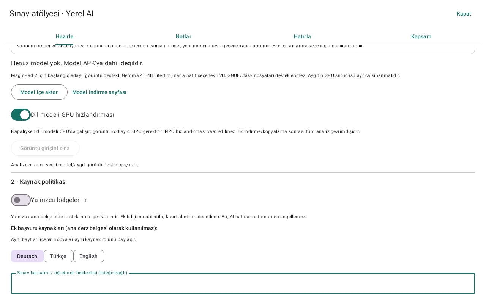
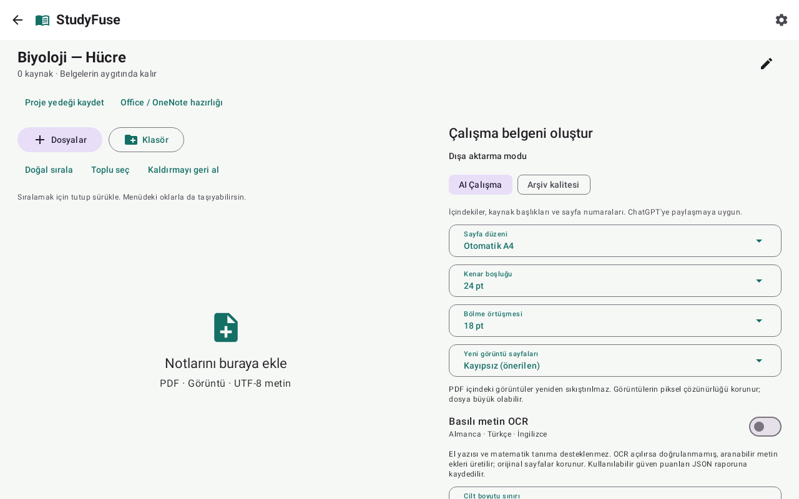

# StudyFuse 1.3 — Automatic offline AI and a source-based study workspace

Compile PDFs, handwritten-note screenshots and UTF-8 text into one organized study document, then prepare source-linked exam notes with an automatically installed on-device vision model. Native Kotlin, Jetpack Compose and Material 3, with a Turkish tablet interface. Android 10+; targets Android 16. The direct APK is **ARM64**, suitable for the HONOR MagicPad 2; CI also builds x86_64 support for emulator testing.

[Download APK](https://github.com/atillahan00/studyfuse/raw/refs/heads/main/downloads/StudyFuse-debug.apk) · [Android Studio project ZIP](https://github.com/atillahan00/studyfuse/raw/refs/heads/main/downloads/StudyFuse-Android-Studio.zip) · [Download checksums](downloads/SHA256SUMS.txt) · [Builds and Android tests](https://github.com/atillahan00/studyfuse/actions/workflows/android.yml)

**Office and OneNote files require source-app PDF export/replacement.** Unsupported sources receive explicit warning pages. Bundled ML Kit OCR recognizes printed Latin text. The separately installed visual language model can interpret handwriting, images, graphs and equations, but those interpretations are **unverified AI drafts**, not guaranteed recognition. The app uses Internet for student-initiated public model downloads, with no mandatory paid API or remote inference. Documents and prompts stay on device; study processing works offline after setup.

## New in 1.3

- **Automatic offline AI setup:** choose the smaller Gemma 4 E2B (2.59 GB) or E4B (3.66 GB). The app downloads a pinned public revision, supports pause/resume and unmetered-network constraints, checks exact byte size/SHA-256 and runs an image-input test before replacing the previous working model. Weights stay outside the small APK.
- **Source-cited study coach:** question answering, simpler explanations, Socratic hints, student-answer feedback, German–Turkish terminology and cross-source comparison. Local search-term rewriting helps cross-language questions retrieve German/Turkish/English material. The model receives bounded excerpts, not an assumption that the entire library fits in one prompt.
- **More practice cards:** generate source-supported questions, review them, create exact-quote cloze cards, use them in the existing spaced practice queue, and optionally export approved cards to Anki TSV.
- **Timed mock exams:** topic-balanced selection from reviewed cards, stored answers/deadline, a hidden answer key until submission/expiry, student self-marking and an exportable response/answer sheet. These are practice exams, not predictions of a teacher's exam or official grading.
- **Daily revision planning:** due questions and previous mistakes guide a time-budgeted plan. The planner is a transparent heuristic; there is no fabricated exam-readiness score or guaranteed grade.
- **Recoverable study state:** source-policy-specific coach history, generated cards, mock responses and reviews are included in project backups. No document uploads, cloud account, subscription or paid API is needed for these workflows.

### Start studying without manual model-file handling

1. Install the APK. Open **Ayarlar → Otomatik AI kurulumu**, or find the same setup card inside **Sınav atölyesi · Yerel AI**.
2. Choose a model and tap **Otomatik kur / sürdür**. The default network choice is unmetered/Wi-Fi. The app shows the several-GB download explicitly; it does not hide that storage/data requirement. A completed download can resume testing offline. An incompatible model/GPU is reported, rather than marked ready.
3. Import your class documents, replace unsupported Office/OneNote inputs with source-app PDFs, and build the PDF. Generate the visual study reading in the exam workshop; inspect its coverage and uncertainties.
4. Open **AI öğrenme merkezi**. Use **Koç** for cited explanations and feedback, **Kartlar** to review/generate cards, **Deneme** for timed practice, and **Plan** for today's study tasks. Exam details remain optional.
5. Approve cards after checking the source. Reviewed cards from the coach also appear in **Sınav atölyesi → Hatırla** for expanding-interval practice.

Automatic setup downloads only public model data using StudyFuse's own GET client. Known bundled-OCR DataTransport backend/job/receiver components are removed; third-party SDK notices and the limits of that configuration are documented. The local AI itself has no remote-inference endpoint. See [setup, sources and privacy](docs/AUTOMATIC_STUDY.md).

## New in 1.2: Sınav atölyesi · Yerel AI



- Real local multimodal inference through pinned **LiteRT-LM 0.16.1**, in a private Android process. Native model failures are isolated from the document UI. No fake/model-free AI answers.
- Streamed SAF import of `.litertlm` files, SHA-256 identity, disk checks and a required randomized image-code input test. Model weights are not bundled or uploaded to this repository.
- Default **Yalnızca belgelerim / Documents Only** policy; optional **Ek kaynaklarla öğren / Enriched Learning** permits labelled local-model knowledge and explicitly marked reference documents. There is **no web retrieval**. Changing mode/model/source/settings invalidates the current study pack.
- Exam preparation works from the uploaded documents alone. Exam scope/date are optional; output can be German, Turkish or English. The teacher's actual exam scope is not inferred as a fact.
- Whole-page reading plus four overlapping close-ups in detailed mode, page/region coverage records, explicit unreadable/failed regions, retained raw responses and source quotation checks. A matching quotation is **not** semantic verification.
- Source-linked topic notes, retrieval questions, self-explanation, diagram recall and evidence-supported worked-example/application prompts. Actual output depends on the model and material; the app does not fabricate missing solutions to fill a quota.
- A source-region viewer beside each region's study material, student correction/review, hidden-answer recall practice, mixed-topic queues, expanding review intervals and an error notebook. Only student-reviewed questions enter practice. Extra-context questions are optional.
- PDF/Markdown export with separate answer keys and uncertainty labels. The exam PDF appends the original compiled PDFs as a visual reference appendix, retaining source diagrams/vector graphics. Citations refer to the source compilation's printed page numbers.
- Completed region checkpoints survive cancellation. Project backups now include study settings, readings, corrections and review history; model weights and temporary images are excluded. Version 1 backups remain readable.

### Manual model import fallback

1. Create/import a project and compile its sources to PDF. Replace unsupported Office/OneNote inputs with source-app PDF exports first.
2. Open **Sınav atölyesi · Yerel AI**. Obtain a compatible image-capable `.litertlm` model in your browser, then choose **Model içe aktar**. A starting candidate is [Gemma 4 E4B mobile](https://huggingface.co/litert-community/gemma-4-E4B-it-litert-lm); E2B is a lighter alternative. GGUF and MediaPipe `.task` files are not supported by this runtime.
3. Run **Görüntü girişini sına**. The synthetic image test checks that this model/backend can read an unpredictable printed code; it does not establish handwriting or mathematical accuracy. Model/runtime file compatibility and GPU drivers still matter.
4. Select the source policy, language and optional exam details. Mark additional reference documents explicitly. **Ayrıntılı görsel okuma** inspects a whole-page view plus four overlapping regions per generated source page.
5. Choose **Sınav hazırlığını oluştur / sürdür**. Inspect **Kapsam** for every failed region and missing source; inspect/correct the notes against the source image. Approve reviewed questions, then use **Hatırla** without looking at the answer first.

Model storage/download size is several GB; runtime memory is additional. Text execution can use CPU or GPU; the image encoder currently uses GPU. No NPU acceleration or MagicPad 2 speed/accuracy is claimed without a device benchmark. Large batches can take substantial time and may need resumed runs. See [local AI design and limits](docs/LOCAL_AI.md).



## New in 1.1

| Feature | Implemented behavior |
|---|---|
| Interactive pagination | Edit cut positions per original PDF/image page, move a selected cut with a slider, regenerate a preview, and compare it with the matching source region. Coverage is checked; long intervals are further tiled when needed. |
| Visual completeness dashboard | Source-by-source status, original/generated page counts, warnings and output ranges. Compare corresponding source/output segments side by side. Missing sources and sources requiring visual review have distinct statuses. |
| Portable backup/restore | A ZIP containing original bytes, replacement PDFs, section names, order, manual pagination, export settings and removed-source undo state. SHA-256, entry names, declared sizes and available storage are validated before an atomic restore to a new project. |
| Search and navigation | Offline original-text/unverified-OCR search, page-number entry, section navigation and thumbnail grids. Viewport rendering makes zooming into long notes memory-conscious. |
| Incremental exports | Verified source conversion checkpoints survive export cancellation. Unchanged sources are reused; layout/content changes invalidate the relevant checkpoint. Corrupt cache is rebuilt. |
| Batch organization | Multi-select, bulk section naming, natural filename sorting, exact-duplicate warnings and reversible removals. Duplicates are never automatically deleted. |
| AI companion files | A Markdown document filtered to visible page bounds, a page search index, and an editable German study prompt. Original visuals remain authoritative; OCR remains unverified. |
| Office preparation | Conversion checklist, individual PDF replacement and batch matching by unique filename stem, with an explicit confirmation before replacement. |
| Upgrade foundation | Database migration from version 1 preserves projects. The published update uses the same development signing key as the original downloadable APK. Optional production signing reads private credentials only from environment variables. |

## Install and update

Install `StudyFuse-debug.apk` on an ARM64 Android 10+ device. This is an evaluation/debug APK, not a Play Store production release. Android may request permission to install from the application opening it. The directly downloadable 1.3 APK retains the previous direct download's development signing key; back up important projects before updating.

CI-generated debug APKs may have a different signing key. Do not uninstall an existing installation to switch keys until its projects have been backed up. Physical-tablet/OEM behavior and arbitrary Office export fidelity are not universally certified.

## Everyday workflow

1. **Yeni proje** or **Dosya içe aktar** starts a project. **Dosyalar** accepts multiple documents; **Klasör** recursively imports a selected folder in natural filename order. Sources are copied into private storage and hashed. A cloud-backed Android document provider may need connectivity to obtain a file before StudyFuse can copy it locally.
2. Long press to reorder, or use the source menu's arrows. **Doğal sırala** puts `2` before `10`. **Toplu seç** enables bulk section naming and removal. **Kaldırmayı geri al** restores the latest removal group. Removed bytes remain private until project deletion and are included in project backups.
3. For Word, PowerPoint, spreadsheets or OneNote, open **Office / OneNote hazırlığı**. Export all relevant content to PDF in the source application. **PDF'leri toplu eşleştir** matches unique basenames, shows the proposed mapping, and waits for your confirmation. Unmatched/ambiguous PDFs are reported for individual selection; nothing is silently skipped.
4. Select **AI Çalışma** for a contents page, section headings, bookmarks and page numbers. **Arşiv kalitesi** omits contents/divider pages. Lossless image encoding is the default. Existing PDF graphics remain vector content. Margins, overlap, output orientation, compression and volume size are configurable.
5. In a PDF/image source menu, choose **Sayfa bölmelerini düzenle**. Cut positions use PDF points from the top of an original page. Edit the list or a slider, press **Bölmeleri önizle**, inspect adjacent generated pages and **Kaynakla karşılaştır**, then save. Original-size mode deliberately does not paginate: choose A4 before editing cuts.
6. **PDF oluştur** runs in the background with progress and cancellation. Verified completed source conversions are retained for a retry. Individual failures get warning pages and an incomplete report; other sources continue safely. Very large or unsupported raster resources retain their encoded PDF data and receive a review warning.
7. Open **Kaynak / çıktı karşılaştırması** to inspect every source's status and jump to the matching output region. The dashboard distinguishes missing content from content included but not fully raster-verified. Comparisons use independent zoom controls; unusual CropBox/MediaBox differences require checking the full source as well.
8. The viewer supports thumbnails, section navigation, direct page entry and **Belgede ara**. OCR matches are labelled **Doğrulanmamış OCR**. Image-only handwriting has no guaranteed searchable text.
9. Save/share the PDF and optionally **Markdown kaydet** or **Almanca istek hazırla**. The German prompt is an offline editable template; it does not contact an AI service. Upload the PDF with its companion text to your chosen assistant and request page-specific analysis.
10. **Proje yedeği kaydet** exports a restorable ZIP. On the home screen, **Yedek geri yükle** creates a separate restored project. Generated PDFs/checkpoints are rebuilt rather than included in the backup. **Ayarlar → Dönüştürme önbelleğini temizle** removes checkpoints without deleting originals.

Documents stay on device unless you explicitly save them through an Android provider or share them with another application. The app does not request broad storage access. Deleting a project deletes its private copies, including removed-source history; exported files elsewhere remain yours.

## Build and test

Use JDK **21**, Android SDK platform **36**, Build Tools **35.0.0** (AGP default) or **36.0.0**, and Android Studio supporting AGP 8.10.1. Accept SDK licenses. Set `ANDROID_HOME` or create `local.properties` with `sdk.dir=/absolute/path/to/android-sdk`. No API keys are required.

```sh
./gradlew :core:test :app:testDebugUnitTest :app:lintDebug :app:assembleDebug :app:assembleDebugAndroidTest
# Smaller ARM64 APK for MagicPad 2:
./gradlew -PstudyfuseAbi=arm64-v8a :app:assembleDebug
# Installable APK: app/build/outputs/apk/debug/app-debug.apk
# Connected Android device/emulator:
./gradlew :app:connectedDebugAndroidTest
# Independent MuPDF verification of generated test PDFs:
python3 -m pip install pymupdf
python3 scripts/verify_pdf_artifacts.py
```

Gradle 8.13 is pinned with a verified distribution checksum. Build dependencies need network on the first build; document processing does not. MuPDF is a development-only verifier, not linked into the Android app. Test reports are under `core/build/reports/tests/` and `app/build/reports/tests/testDebugUnitTest/`; lint is under `app/build/reports/`.

The GitHub workflow installs supported SDK packages explicitly, runs tests/lint, builds APKs and retains artifacts. The [1.3 validation run](https://github.com/atillahan00/studyfuse/actions/runs/41199749074) has passed the build/tests/lint and pinned public-model checks. The local full suite passed **97 JVM/Robolectric tests**, and independent MuPDF checks verified all 200 markers of the tall-page fixture. Android runtime results are recorded separately in [validation evidence](docs/VALIDATION.md). Deterministic inference adapters validate pipeline behavior, not neural handwriting accuracy.

For an independently managed production signing key, set `STUDYFUSE_SIGNING_STORE`, `STUDYFUSE_STORE_PASSWORD`, `STUDYFUSE_KEY_ALIAS`, and `STUDYFUSE_KEY_PASSWORD`, then build `:app:assembleRelease`. Keep the same key for updates and keep it private. No signing keys or passwords are committed. CI validation artifacts are not a substitute for a persistent release signing setup.

## Architecture and limitations

- `core/`: format detection, natural sorting, export settings, manual/automatic pagination and geometric coverage checks.
- `app/.../data/`: Room schema/migration, SAF import, transaction-safe backup/restore and source metadata.
- `app/.../engine/`: conversion adapters, source checkpoints, vector assembly, coverage reports and bounded companion-text extraction.
- `app/.../ui/`: Turkish Compose screens, pagination editor, comparison dashboard, viewport viewer and prompt editor.
- `app/src/test/`: conversion, archive, migration, cache, text, database and Compose tests.
- `app/src/androidTest/`: tests that need an actual Android runtime.

Read [format support](docs/FORMATS.md), [OneNote feasibility](docs/ONENOTE.md), [known limitations](docs/KNOWN_LIMITATIONS.md), [architecture](docs/ARCHITECTURE.md), [validation evidence](docs/VALIDATION.md), [local AI](docs/LOCAL_AI.md) and [third-party licenses](THIRD_PARTY_NOTICES.md). [Example output](examples/StudyFuse-example.pdf) uses a synthetic long handwritten-style fixture, not a real teacher's notebook. An openable PDF, source hash, OCR confidence score or geometric coverage check alone is never treated as proof that every original mark was preserved.
